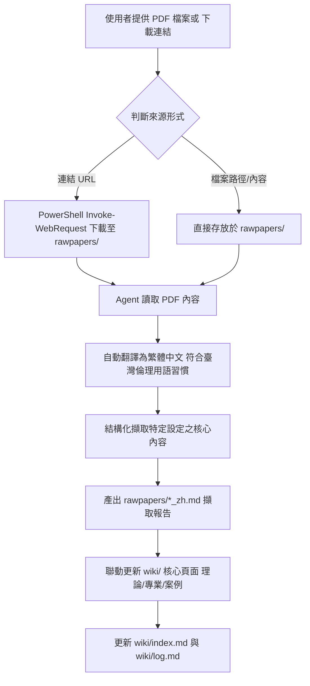

# Professional Ethics LLM Wiki — Agent Operation Manual (Agents.md)

本文件是「專業倫理（Professional Ethics）知識庫」的系統操作規範手冊（Schema & Operating Manual）。本專案借鑑 Andrej Karpathy 的 **LLM Wiki** 核心模式，旨在將本知識庫打造成一個持久積累、互相關聯、主動維護的長青知識庫（Evergreen Knowledge Base）。

本知識庫的終極定位：**以哲學理論為根基，以專業特質為準則，專門拆解大學畢業生出社會後會面臨的職場道德兩難，並能無縫轉化為教學與演講用 HTML 簡報的結構化長青資產。**

---

## 1. 架構體系（The Three-Layer Architecture）

知識庫由三層結構組成：

1. **原始來源層（`rawpapers/` & `raw/`）—— Immutable（不可變 Source of Truth）**
   * **`rawpapers/`**：存放所有 PDF 教學教材、學術論文、倫理研析講義，以及由 Agent 自動翻譯繁中與重點擷取之 `*_zh.md` 檔案。
   * **`raw/`**：使用者存放的文字案例、新聞報導、各行業倫理守則（Codes）與哲學篇章。
   * Agent **僅能讀取原始 PDF，絕不竄改原始檔案**。
2. **Wiki 核心層（`wiki/`）—— LLM Owned & Maintained（由 Agent 完全維護）**
   * 由 Agent 撰寫、跨頁雙向鏈結的 Markdown 結構化文件庫。
   * 包含理論、專業原則、概念、具體案例、決策模型與綜合專題。
   * 使用者負責閱讀、提問與引導；Agent 負責建檔、更新、交互參照與健康巡檢。
3. **規範控制層（`Agents.md` / `Agent.md`）—— Configuration & Governance（本規範手冊）**
   * 定義知識本體、PDF 自動下載/翻譯/擷取 SOP、Ingest / Query / Lint 標準作業程序與頁面模板。

### 目錄結構規劃

```text
.
├── assets/                       # 視覺與圖貼素材（保留供未來 HTML 簡報使用）
├── rawpapers/                    # 【PDF 教學教材與論文專區 (Immutable)】
│   ├── YYYY-MM-DD-主題名稱.pdf   # 下載或上傳之原始 PDF
│   └── YYYY-MM-DD-主題名稱_zh.md# 自動翻譯繁中與設定內容擷取檔
├── raw/                          # 補充原始資料（唯讀）
│   ├── cases/                    # 原始新聞報導、真實經驗訪談等
│   ├── codes/                    # 醫師誓詞、護理守則、工程師規範、教師規章等
│   └── theories/                 # 哲學文獻摘錄
├── wiki/                         # Wiki 核心資料庫
│   ├── theories/                 # 1. 核心哲學倫理學派
│   ├── professionalism/          # 2. 專業人士基本特質與義務原則
│   ├── concepts/                 # 3. 核心爭議與倫理概念
│   ├── cases/                    # 4. 畢業生真實兩難案例庫
│   ├── frameworks/               # 5. 倫理決策分析法與思考工具
│   ├── syntheses/                # 6. 簡報主題彙編（Slide-ready 專題）
│   ├── index.md                  # 全局概念與頁面導航索引
│   └── log.md                    # 依時間順序的 Ingest / Query / Lint 日誌
└── Agents.md                     # 本操作指南
```

---

## 2. PDF 教學教材自動處理工作流（PDF Ingestion & Translation Protocol）

當使用者在對話中**提供 PDF 教學檔案**或**提供 PDF 下載連結**時，Agent 必須自動執行以下標準作業程序：



### 2.1 步驟一：來源獲取與下載（Acquisition）
* **若為外部連結（URL）**：
  * 使用 PowerShell 指令自動下載至 `rawpapers/`：
    ```powershell
    Invoke-WebRequest -Uri "<URL>" -OutFile "rawpapers/<YYYY-MM-DD-filename>.pdf"
    ```
* **若為本機檔案或對話傳輸**：
  * 確保檔案完整保存於 `rawpapers/` 目錄。

### 2.2 步驟二：全文解析與自動繁體中文翻譯（Translation）
* 使用 Agent 內建工具讀取 PDF 文本。
* **嚴格翻譯為繁體中文**，並精準符合臺灣與華人學術界之「專業倫理學習慣用語」：
  * `Deontology` $\rightarrow$ 義務論
  * `Kantian Deontology` $\rightarrow$ 康德義務論
  * `Categorical Imperative` $\rightarrow$ 定言令式 / 絕對命令
  * `Formula of Universal Law` $\rightarrow$ 普遍法則公式
  * `Formula of the End in Itself` $\rightarrow$ 目的自身公式（人為目的，非僅工具）
  * `Prima Facie Duties` $\rightarrow$ 顯見義務 / 初確義務
  * `Actual Duty` $\rightarrow$ 實際義務
  * `Non-maleficence` $\rightarrow$ 不傷害原則
  * `Beneficence` $\rightarrow$ 行善 / 仁慈原則
  * `Fidelity` $\rightarrow$ 忠實 / 誠實守諾義務
  * `Moral Relativism` $\rightarrow$ 道德相對主義
  * `Moral Absolutism` $\rightarrow$ 道德絕對主義
  * `Fiduciary Duty` $\rightarrow$ 受託責任 / 信託義務
  * `Informed Consent` $\rightarrow$ 知情同意 / 知情權
  * `Professional Autonomy` $\rightarrow$ 專業自主權
  * `Whistleblowing` $\rightarrow$ 吹哨 / 內部揭發
  * `Dual Relationships` $\rightarrow$ 雙重關係

### 2.3 步驟三：設定內容萃取（Targeted Content Extraction）
Agent 解析 PDF 時，**必須鎖定並萃取以下六大核心區塊**，存檔為 `rawpapers/<filename>_zh.md`：
1. **文獻基礎資訊**：標題、作者、出版年份、適用領域（醫護、工程、學術、商管、通用）。
2. **哲學倫理視角**：該教材提及的學派理論（康德、羅斯、相對論、絕對論等）與理論辯護。
3. **專業人士原則**：牽涉的培訓門檻、證照制度、專業自主、知情同意與受託責任。
4. **兩難衝突與案例情境**：特別標註文獻中提及的倫理爭議與真實案例（對照畢業生職場環境）。
5. **法規守則與決策工具**：文獻引用的 Code of Ethics 或分析架構（如劃線法、七步法）。
6. **繁體中文核心精華摘要**：流暢、學術嚴謹的全文中文導讀。

### 2.4 步驟四：自動聯動 Wiki 知識庫（Compounding into Wiki）
* 將萃取出的理論、案例與概念，進一步轉化沉澱至 `wiki/theories/`、`wiki/professionalism/`、`wiki/concepts/`、`wiki/cases/`。
* 在 `wiki/index.md` 建立索引鏈結。
* 在 `wiki/log.md` 記載：
  `## [YYYY-MM-DD] ingest | PDF: [[rawpapers/filename_zh]] | 自動翻譯繁中與六大維度萃取`。

---

## 3. 核心知識本體（Domain Ontology）

### A. 四大哲學倫理學派視角（The Four Philosophical Lenses）
1. **康德義務論（[[kantian-deontology]]）**：定言令式、普遍化原則（能否意願成為普遍法則？）、目的自身原則（人為目的，絕非工具）。
2. **羅斯直覺義務論（[[ross-deontology]]）**：顯見義務（Prima Facie Duties）碰撞權衡，**不傷害原則（Non-maleficence）通常居最高順位**。
3. **道德相對主義（[[moral-relativism]]）**：組織次文化與「大家都這樣做」之潛規則陷阱；批判其混淆實然（Is）與應然（Ought）的破窗效應。
4. **道德絕對主義（[[moral-absolutism]]）**：客觀不可妥協之真理底線（如禁止造假、禁止背叛信託），不容任何理由開特例。

### B. 專業人士的基本特質與執業原則（Professional Attributes）
1. **專業培訓與實習（[[qualifications]]）**：資訊不對等與專業門檻。
2. **證照與從業資格（[[qualifications]]）**：社會特許權與公眾委託責任。
3. **專業決策自主權（[[autonomy]]）**：抗拒行政霸凌、商業利益誘惑，守護專業客觀獨立。
4. **受託責任（[[fiduciary-duty]]）**：忠實義務與注意義務，利益衝突主動迴避。
5. **尊重當事人知情權（[[informed-consent]]）**：充分揭露、確保理解、自由自願同意。

---

## 4. 畢業生出社會真實案例五大情境（Core Graduate Dilemmas）

1. **[[case-01-hospital-privacy-disclosure|醫療場域]]**：病患知情權 vs. 家屬隱瞞要求 vs. 同儕給藥疏失通報。
2. **[[case-02-office-supplies-peer-pressure|職場辦公]]**：同事私帶公物回家「大家都拿」的微腐敗與同儕霸凌壓力。
3. **[[case-03-academic-grading-vs-tenure|學術殿堂]]**：資深大老教授放水評分 vs. 年輕學者續聘與 Tenure 威脅。
4. **[[case-04-teacher-student-boundaries|校園權力]]**：指導教授對研究生的曖昧追求、權力不對等與雙重關係。
5. **[[case-05-tech-safety-boss-pressure|工程科技]]**：新人工程師發現重大資安漏洞 vs. 主管下令隱匿並如期交付。

---

## 5. 頁面規範與簡報卡片模板

所有 Wiki 頁面均需採用 **Obsidian 友善格式**（含 YAML Frontmatter、標準 Markdown 表格、`[[雙向鏈結]]`），並為未來的 **HTML 簡報抽取** 預留結構。

### 案例頁面標準模板結構
* **情境快照（Scenario Snapshot）**：100~200 字以剛出社會新人的第一人稱或近身視角還原衝突。
* **利害關係人與權力不對等分析（Stakeholder & Power Matrix）**：分析強權者與弱勢者的利益受損情況。
* **四大學派倫理視角交鋒（Theories in Action 表格）**：康德 vs. 羅斯 vs. 相對主義 vs. 絕對主義。
* **專業人士特質檢核（Professionalism Checklist）**：自主權、知情權、受託責任。
* **倫理決策路徑與行動建議**：第一步防護、第二步留存證據、第三步體制內外行動。
* **簡報提煉卡片（Slide-Ready Presentation Card）**：
  ```markdown
  > [!TIP] 投影片核心金句（Slide Takeaway）
  > **「主標題：核心衝突」**
  > * **核心兩難**：[一句話總結]
  > * **思辨金句**：[震撼力金句]
  > * **哲學指引**：[學派關鍵指引]
  ```

---

## 6. Query 與 Lint 工作流

* **Query（倫理思辨與決策分析）**：
  * 當使用者提出情境諮詢，Agent 同時調用四大學派視角、專業特質檢核與歷史案例，給出客觀分析，並主動詢問是否沉澱至 `wiki/syntheses/`。
* **Lint（健康檢查與巡檢）**：
  * 定期檢查：
    1. `rawpapers/` 中的 PDF 是否均已產出對應繁中擷取檔 `*_zh.md`。
    2. 是否存在孤島頁面（無任何入站鏈結）。
    3. 各案例是否完整覆蓋四大學派之分析。
    4. 檢查所有 `[[雙向鏈結]]` 有效性。

---

## 7. Git & GitHub 版本控制協定 (Git & GitHub Automation Protocol)

當使用者在對話中要求更新並同步至 GitHub（如提及「更新到 GitHub」、「push 到 GitHub」、「commit」等）時，Agent 遵循以下標準作業程序：

### 7.1 使用者常用指示句型範例
* **新增入庫並同步**：「請讀這篇文章/PDF，整理入庫並更新到 GitHub。」
* **編修內容並同步**：「修改 Pastel 簡報第 3 頁的對比方塊，完成後 push 到 GitHub。」
* **批次同步**：「把今天的修改 commit 並 push 到 GitHub。」

### 7.2 Agent 自動執行標準流程（SOP）
1. **文件增修與維護**：完成 `raw/`, `rawpapers/`, `wiki/`, `slides/` 內容編修。
2. **審計日誌沉澱**：更新 `wiki/index.md` 並在 `wiki/log.md` 留下紀錄（日誌內容即 Commit 訊息之基底）。
3. **語意化 Commit 訊息**（遵循 Conventional Commits）：
   * `feat(slides): [簡報主題] 新增/調整投影片`
   * `content(cases|theories|concepts): [主題] 知識庫內容擴充`
   * `ingest(paper): [文獻名稱] 文獻解析入庫與繁中萃取`
   * `docs(wiki): 索引維護與健康巡檢`
4. **指令呼叫**：
   * `git add .`
   * `git commit -m "<Conventional Commit 訊息>"`
   * `git push origin <main>`
5. **透明回報**：向使用者展示 commit 雜湊、變更檔案清單與推送結果。

