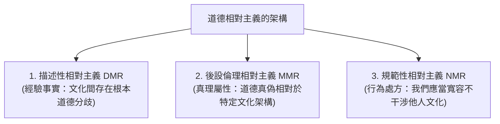

# 史丹佛哲學百科全書（SEP）精讀解析：道德相對主義的哲學體系與爭端（Moral Relativism）

> **【出處標註與文獻資訊】**  
> * **詞條標題**：Moral Relativism  
> * **執筆學者**：Prof. Chris Gowans（福坦莫大學哲學系教授，倫理學與佛教哲學專家）  
> * **發表平台**：*Stanford Encyclopedia of Philosophy (SEP)*（史丹佛哲學百科全書，主編：Edward N. Zalta）  
> * **原始連結**：[https://plato.stanford.edu/entries/moral-relativism/](https://plato.stanford.edu/entries/moral-relativism/)  
> * **歸檔位置**：`raw/theories/sep-moral-relativism_zh.md`

---

## 1. 文獻核心定位與哲學問題意識

道德相對主義（Moral Relativism）是倫理學史與當代實踐中最常被提及、但也最常被誤解與濫用的理論之一。

本詞條由 Chris Gowans 教授執筆，對道德相對主義進行了嚴格的哲學界定，將其從大眾粗淺的「每個人有自己的看法」或「多元包容」口號中抽離，精準解構為**描述性、後設倫理學與規範性**三個層面，並全面剖析了其面臨的四大致命邏輯反駁（寬容悖論、道德進步難題、群體界定困境、實然與應然的混淆）。

---

## 2. 道德相對主義的三大根本形態（Three Forms of Moral Relativism）

Gowans 教授指出，理解相對主義的第一步，是嚴格區分以下三種截然不同的哲學主張：

### A. 描述性道德相對主義（Descriptive Moral Relativism, DMR）
* **哲學屬性**：經驗性（Empirical）、描述性（Descriptive）的事實宣稱。
* **核心主張**：在人類學與歷史的客觀事實上，不同的社會、文化、社群或時代之間，**存在著廣泛、深層且無法化約的根本道德分歧（Fundamental Moral Disagreements）**。
* **局限與澄清**：DMR 僅描述了「世界上有分歧」這個事實（Is），它本身**並不蘊含**「這些分歧在哲學上都是對的」或「不存在客觀真理」的規範結論。

### B. 後設倫理道德相對主義（Metaethical Moral Relativism, MMR）
* **哲學屬性**：後設倫理學（Metaethics）關於道德概念本質與真理屬性的理論。
* **核心主張**：
  * **否認客觀普遍道德真理**：不存在超越所有文化或理性框架的「客觀道德真理（Objective Moral Truth）」。
  * **真理的相對性**：道德判斷（如「一夫多妻是不道德的」或「隱瞞公司漏洞是不道德的」）的真假與正當性，**完全取決於（Relative to）特定群體所共有的傳統、信念、習俗或協議架構**。
  * 在架構 A 之中為真的道德命題，在架構 B 之中完全可能為假；且不存在任何架構中立的客觀標準可裁決孰優孰劣。
* **當代代表人物**：
  * **吉爾伯特·哈曼（Gilbert Harman）**：主張道德源於特定社會群體成員之間的**隱性協議與協商（Implicit Bargaining/Agreements）**。
  * **黃百銳（David B. Wong）**：提出**多元相對主義（Pluralistic Relativism）**，認為人類生物本能與社會協作對道德設立了基本約束，但在這些約束之內，允許存在多種同樣具備正當性的道德體系。

### C. 規範性道德相對主義（Normative Moral Relativism, NMR）
* **哲學屬性**：規定我們「應當如何行動（Ought）」的規範倫理學主張。
* **核心主張**：因為道德是相對的，所以**任何人都不應當以自己群體的道德標準去干涉、批判或強制制裁具有不同道德標準的其他群體**，我們應當抱持無條件的「寬容（Tolerance）」。

---

## 3. 哲學界對道德相對主義的四大經典反駁（Objections & Critiques）

SEP 詞條深入梳理了分析哲學對道德相對主義最著名的邏輯挑戰：

### 1. 寬容悖論與自我反噬（The Incoherence / Paradox of Tolerance）
* **致命矛盾**：如果規範性相對主義主張「所有人都**應當（Ought）**保持寬容」，那麼**「寬容」本身豈不就成了一條放諸四海皆準的「客觀、普遍、絕對的道德律令」？**
* 這直接推翻了相對主義「不存在普世道德標準」的前提，陷入**自我反噬（Self-Refuting）**。
* 反之，如果寬容也是相對的，那麼當某個文化或霸凌團體將「壓迫、侵略與不寬容」視為其神聖傳統時，相對主義者就**喪失了任何跨架構的道德資格去譴責他們**。

### 2. 道德進步與改革難題（The Problem of Moral Progress）
* **反駁邏輯**：如果一個社會行為的對與錯完全由當下該社會的文化共識所定義，那麼：
  * **「廢除奴隸制度」或「爭取女性投票權」就不能被稱為「道德進步（Progress）」**，而只能被冷酷地稱為「道德品味的歷史變遷（Mere Change）」。
  * 歷史上的改革者與先驅（如馬丁·路德·金恩、曼德拉），在當時都嚴重挑戰了該社會的主流法律與文化潛規則。在純粹相對主義眼中，**這些挑戰社會常態的改革者在當時必然被判定為「在道德上是錯誤的」**！
* 相對主義因此成了保守主義、扼殺道德自我更新與反省的遮羞布。

### 3. 群體邊界劃定難題與主觀主義滑坡（The Problem of Group Boundaries）
* **定義困境**：相對主義聲稱道德相對於「所屬社群/群體」，但**究竟什麼算是一個「群體」？**
* 在現代複雜社會中，一個人同時屬於國家、宗教、城市、跨國企業、部門科室、同儕小圈子。如果一個剛畢業的菜鳥工程師，其國家的法律說禁止造假，但其專案小組的次文化卻說「上線前隱匿漏洞是慣例」，相對主義無法給出他該效忠哪一個「群體標準」。
* 若把群體無限制細分下去，相對主義最終將不可避免地崩塌為**「個人主觀主義（Individual Subjectivism）」**（每個人自成一個標準），使得「道德義務」徹底失去任何人際約束力。

### 4. 混淆「事實認知分歧」與「根本道德分歧」
* 人類學家觀察到的許多文化習俗差異，根本不是道德原則的衝突，而是對**「非道德客觀事實（Non-Moral Facts）」**的認知不同。
* 範例：某些部落禁止食用某種動物，並非因為他們不重視生命福祉，而是因為宗教信仰使他們相信祖先的靈魂轉世在該動物體內。在「應當尊重祖先」的核心道德原則上，不同文化其實存在驚人的一致性。

---

## 4. 對職場與專業倫理之致命啟示（The Trap of "Everyone Does It"）

本篇 SEP 詞條對於大學畢業生出社會面對的道德兩難，提供了最強大的防禦疫苗：

1. **破除「辦公室次文化（Corporate Subculture）」的相對主義催眠**：
   * 在 [[case-02-office-supplies-peer-pressure]] 中，老鳥同事說：「這在我們部門是公開秘密，大家都拿！」
   * SEP 詞條精闢指出：**「大家都這樣做（DMR 描述事實）」絕對不等於「這樣做在道德上是正當的（Normative justification）」！** 將組織現狀等同於道德正當性，是犯了混淆實然與應然的哲學謬誤。
2. **警惕平庸之惡與同儕破窗**：
   * 相對主義往往被用作新人同流合汙的心靈麻醉劑。當新人妥協並對自己說「入境隨俗」時，他實際上已經放棄了身為**道德能動者（Moral Agent）**的獨立批判能力。
3. **專業人士的跨文化與跨群體底線**：
   * 專業倫理（如醫師誓詞、工程師安全守則、會計審計規範）是超越單一公司或辦公室小圈子的普世職業契約。專業人員的最高效忠對象是專業標準與公眾信託，絕非部門主管私下定義的「潛規則相對主義」。
