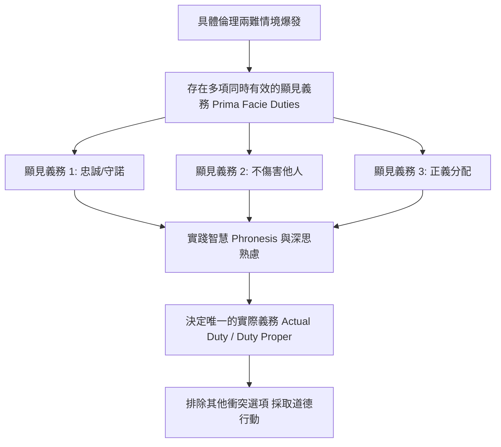

# 史丹佛哲學百科全書（SEP）精讀解析：威廉·大衛·羅斯的直覺義務論哲學體系

> **【出處標註與文獻資訊】**  
> * **詞條標題**：William David Ross  
> * **執筆學者**：Anthony Skelton 教授  
> * **發表平台**：*Stanford Encyclopedia of Philosophy (SEP)*（史丹佛哲學百科全書，哲學界最高權威同儕審查資料庫，主編：Edward N. Zalta）  
> * **原始連結**：[https://plato.stanford.edu/entries/william-david-ross/](https://plato.stanford.edu/entries/william-david-ross/)  
> * **核心經典著作**：W. D. Ross 所著《正當與善》（*The Right and the Good*, 1930）與《倫理學基礎》（*Foundations of Ethics*, 1939）  
> * **歸檔位置**：`raw/theories/sep-william-david-ross_zh.md`

---

## 1. 文獻背景與學理地位概述

蘇格蘭哲學家威廉·大衛·羅斯爵士（Sir William David Ross, 1877–1971）是 20 世紀最重要的道德哲學家之一，同時也是享譽國際的亞里斯多德經典著作翻譯與註疏權威。

羅斯在 1930 年出版的里程碑著作《正當與善》（*The Right and the Good*）中，開創性地提出了**「多元直覺主義義務論（Pluralistic Intuitionist Deontology）」**。他同時對抗了當時統治學界的兩大陣營：
1. **康德的單一絕對義務論（Kantian Absolutist Monism）**：批判康德將所有道德簡化為定言令式，且堅持「絕不說謊」的僵化無例外教條，脫離了人類常識道德。
2. **功利主義 / 理想效益主義（Utilitarianism & Ideal Utilitarianism）**：批判邊沁、密爾以及 G. E. 摩爾（G.E. Moore）將一切行為的正當性完全繫於「未來結果的好壞」，抹殺了人際關係的特殊道德承諾。

羅斯由此建立了**「顯見義務（Prima Facie Duties）」**架構，成為當代專業倫理學（尤其是醫學、工程與商業倫理）在處理道德衝突時最核心的分析工具。

---

## 2. 羅斯對兩大陣營的根本性哲學批判

### A. 對功利主義（Utilitarianism）的致命一擊
* **忽視「回溯性義務（Backward-Looking Duties）」**：
  * 功利主義完全是「前瞻導向（Forward-looking）」的，認為義務只存在於「未來能創造多少效益」。
  * 羅斯指出，人類的大量關鍵義務根本不是由未來後果決定的，而是由**「過去發生的事實（Past facts）」**所產生的：
    * **守諾（Fidelity）**：源於過去自己曾經對他人許下的承諾。
    * **補償（Reparation）**：源於過去自己曾對他人造成的過失傷害。
    * **感恩（Gratitude）**：源於過去他人曾無私給予自己的幫助。
* **抹殺「義務的高度個人特質（The Highly Personal Character of Duty）」**：
  * 羅斯的名言精闢指出：*「理想功利主義理論的本質缺陷在於，它忽略了——或至少沒有充分重視——義務那高度個人的特質。」*
  * 功利主義把人類簡化為抽象的「幸福福利分配點」。但羅斯強調，我們不是面對抽象的世界整體，而是身處具體的人際承諾關係中（如受託人與委託人、醫生與病患、父母與孩子）。一個行為是否正當，與**受影響者和行動者之間的具體身分關係**密切相關。

### B. 對康德義務論（Kantianism）的修正
* 康德主張道德法則絕對無例外（如面對門口兇手追問仍不可說謊）。羅斯指出，這嚴重背離了人類的**常識道德（Common-Sense Morality）**。
* 當「守諾」會導致嚴重的傷亡或災難時，任何具有正常道德常識的人都會同意：打破承諾去拯救生命才是當下真正的義務。

---

## 3. 核心理論範疇：顯見義務 vs. 實際義務

羅斯最革命性的貢獻，在於精確區分了道德特質的兩種狀態：

### 1. 顯見義務（Prima Facie Duties / Conditional Duties）
* **定義**：在「其他條件相同（Other things being equal）」的前提下，行動具有的客觀道德正當性傾向。
* **特性**：它並非「虛假的表面假象」，而是具有客觀且持續存在的道德重量（Objective moral weight）。即便在特定情境中被其他更高義務壓倒，它依然存在，並常以**「道德殘留（Moral Residue）」**的形式要求我們事後進行解釋、道歉或補償。

### 2. 實際義務（Actual Duty / Duty Proper）
* **定義**：行動者在權衡了具體情境中所有相互衝突的顯見義務後，**最終在當下這個具體時空中，必須付諸實踐的唯一真正義務**。

---

## 4. 羅斯的七大顯見義務完整清單與分類

羅斯依據義務的起源與道德性質，歸納出七項基本的顯見義務：

| 義務群組 | 具體顯見義務 | 道德立論基礎與意涵 | 專業職場實踐範例 |
| :--- | :--- | :--- | :--- |
| **群組一： 源於過去行動之義務** | **1. 忠誠（Fidelity）** | 源於過去自己許下的明確承諾或默示承諾（包含說實話之誠信）。 | 恪守聘僱保密協議、向委託人如實揭露真實資訊。 |
|  | **2. 補償（Reparation）** | 源於過去自己對他人所犯下的不正當行為。 | 發現工程或給藥疏失時，第一時間主動補救並賠償受害者。 |
| **群組二： 源於他人過去行動** | **3. 感恩（Gratitude）** | 源於過去他人曾為自己提供的善意服務或幫助。 | 感念導師前輩提攜（但不能凌駕於更高原則之上）。 |
| **群組三： 正義與公平義務** | **4. 正義（Justice）** | 防止或修正幸福與利益未能按照功績（Merit）分配的不公狀態。 | 拒絕因主管人情而給予特權金主二代不實高分；同工同酬。 |
| **群組四： 改善世界狀態之義務** | **5. 仁慈/行善（Beneficence）** | 增進他人的人格德行、智慧認知或無害之快樂。 | 主動協助身處困境的菜鳥新人；優化系統使用者體驗。 |
|  | **6. 自我提升（Self-Improvement）** | 提升自己的道德水平、專業智能與技術素養。 | 持續參加在職培訓，維持執照的專業水準。 |
| **群組五： 不可傷害之義務** | **7. 不傷害他人（Non-Maleficence）** | **最優先之義務**：避免主動對他人施加身體、心靈、隱私或財產損害。 | 嚴禁上線帶有已知致命漏洞的軟體；嚴禁包庇有害病患的重大疏失。 |

> [!IMPORTANT] 羅斯論「不傷害原則」的超然地位
> 羅斯在《正當與善》中特別強調：**「不傷害他人（Non-maleficence）的義務，在顯見性上明確被視為比仁慈行善（Beneficence）更加具有約束力（Prima facie even more binding than that of beneficence）。」**
> 人類最重要的底線是不去加害他人，這項消極禁止令具有壓倒多數積極行善的絕對加權重。

---

## 5. 道德知識論：直覺主義與實踐智慧（Epistemology）

面對「我們如何知道哪些是義務？」的提問，羅斯提出了深刻的知識論解答：

1. **顯見義務原則具有「自明性（Self-Evidence）」**：
   * 羅斯主張**道德直覺主義（Moral Intuitionism）**。七大顯見義務的客觀正當性，如同數學幾何公理（如兩點之間直線最短），當一個心智成熟、具備理性反省能力的人經過審慎思考後，其自明性會自然呈現。
   * 我們不需要透過複雜的科學實證或演繹論證來「證明」為什麼不應無故害人或說謊。
2. **實際義務判定「不具自明性」，仰賴「實踐智慧（Phronesis / Judgment）」**：
   * 羅斯明確承認：**在具體衝突中判定哪一項顯見義務晉升為「實際義務」，絕對不具備自明性，也不存在機械化的量化算法！**
   * 我們只能依靠類似亞里斯多德的「實踐智慧（Phronesis）」，結合道德敏感度、對事實全貌的理解，做出**「深思熟慮的意見（Considered Opinion / Probable Judgment）」**。
   * 我們在採取實際行動時，永遠無法享有像數學般的絕對確定性，但這正是人類道德生活的真實處境。

---

## 6. 羅斯的內在價值論（Theory of Goodness）

羅斯同時是一位價值多元論者，主張世上有**四種自身即善（Intrinsically Good）**的事物：
1. **德行（Virtue）**：追求道德正當、克己守法的行動意志。
2. **知識與正確認知（Knowledge）**：對真理的掌握與科學智識。
3. **快樂（Pleasure）**：正當、無辜的幸福與喜悅。
4. **正義相配（The proportion of pleasure to virtue）**：善有善報、德行高尚者享有相稱的幸福。

---

## 7. 對專業倫理知識庫之重大價值總結

本篇史丹佛哲學百科全書的精讀，為我們的 LLM Wiki 提供了最堅實的學理武裝：
1. **為受託人角色辯護**：「義務的高度個人特質」完美解釋了為何專業人員對其客戶/病患具有凌駕於公眾效益之上的特殊忠誠。
2. **不傷害原則的排序權限**：為畢業生在面對「主管命令」與「公眾安全」衝突時，提供了壓倒性的排序裁判權。
3. **承認道德兩難的沉重**：羅斯承認道德決策沒有廉價的速食答案，培養新人的「實踐智慧（Phronesis）」才是專業倫理教育的終極目的。
