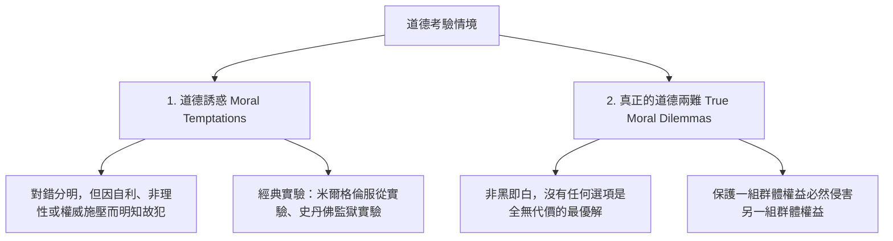

# 講義精華解析：何謂倫理學與專業倫理？（What are Ethics? & Professional Ethics）

> **開篇名言**：  
> *「事實的真相是，你永遠知道正確該做的事是什麼。困難的地方在於去執行它。」*  
> —— 諾曼·史瓦茲柯夫將軍（General Norman Schwarzkopf）

---

## 1. 文獻基礎資訊（Bibliographic Information）
* **文獻標題**：What are Ethics? & Professional Ethics: Comprehensive Structured Study Guide & Key Concept Annotations
* **課程年度**：2026 年秋季課程講義（Fall 2026 Class Notes）
* **適用領域**：通用專業倫理、行為倫理學、管理與工程道德決策
* **核心主題**：倫理定義、規範倫理學 vs 描述倫理學、價值觀形成、普世道德律、道德情境分類（誘惑 vs 兩難）、經典社會心理學實驗、超越法律底線、倫理連續光譜。

---

## 2. 哲學倫理視角（Philosophical Lenses & Theoretical Framing）

### A. 規範倫理學（Prescriptive Ethics）vs. 描述/行為倫理學（Descriptive / Behavioral Ethics）
本講義開宗明義區分了哲學家與社會科學家的兩種根本研究進路：
1. **規範性進路（應然 - How we SHOULD act）—— 道德哲學家主導**：
   * 著重於「知識（Knowledge）」與尋找道德問題的「正確解答」。
   * 包含**結果論（Consequentialism）**（為最多數人追求最大福祉）與**義務論（Deontological theories）**（遵循規則、義務與絕對原則）。
2. **描述性進路（實然 - What we ACTUALLY do）—— 社會科學家主導**：
   * 著重於「行為（Behaviour）」與現實觀察。學者 L. K. Trevino 與 K. A. Nelson 指出：人類並非隨時都在做理性最優決策，即使在原則上達成共識，現實中我們常受**自私自利（Self-interest）**驅使，或刻意窄化對後果的評估。
   * **行為倫理學（Behavioral Ethics）**：專門研究人們在真實面臨倫理挑戰時的真實行為樣貌。

### B. 價值觀形成與普世道德律（Universal Moral Laws）
* **價值觀來源**：童年家庭環境、父母身教言教、宗教與政治信念，隨成長受同儕社群（Peers & Community）深刻形塑。
* **全球倫理學會（Institute of Global Ethics）五大普世核心價值**：
  1. **誠實（Honesty）**
  2. **責任（Responsibility）**
  3. **公平（Fairness）**
  4. **尊重（Respect）**
  5. **同理/慈悲（Compassion）**
* **黃金法則（The Golden Rule）**：跨文化普遍存在的利他（Altruism）、同理心與歸屬感共識。

---

## 3. 兩難衝突與案例情境（Situations & Behavioral Experiments）

講義精闢指出人類面對的**兩種不同道德情境**：

### 1. 道德誘惑（Moral Temptations）
* **定義**：對錯**顯而易見**，但個人因慾望、利益、從眾或欠缺理性思考，而「明知故犯」未能遵守原則。
* **經典心理學實驗佐證**：
  * **史丹利·米爾格倫服從實驗（Stanley Milgram Experiment）**：揭示在權威命令下，高達 65% 的普通受試者會對無辜者施加致命伏特電擊，呈現權威服從如何壓垮個人道德直覺。
  * **史丹佛監獄實驗（Stanford Prison Experiment）**：揭示角色扮演與體制情境力量，如何在短時間內讓普通大學生化身為虐待狂獄警。

### 2. 真正的道德兩難（True Moral Dilemmas）
* **定義**：對錯**並不顯著**。
* **特性**：所有可行方案皆非最佳解（None of the alternative courses of action seem optimal）。保護了甲群體的權利，就必然侵害乙群體的權利；捍衛了誠實，就可能背叛了忠誠。

---

## 4. 專業人士原則與法律超越（Ethics Beyond the Law）

### A. 法律只是道德的最低底線（Legal Standards = Minimum Conduct）
* 倫理學涵蓋範疇遠遠超出法律邊界。身為真正的專業倫理從業者，**絕不能以「合乎法律規定」自滿**。
* **道德能動者（Moral Agent）**：倫理人必須具備獨立道德主體意識，勇於**抵制不符合倫理的法律或惡性規定**。

### B. 倫理行為的三種層次模式
1. **消極不作為（Passive Avoidance）**：聚焦於「不去做違法/不道德的事」，不主動發起惡意行為。
2. **被動反應型（Reactive Mode）**：在面對同儕壓力、他人惡行或意外的不當利益誘惑時，選擇抗拒並做出合乎倫理的反應，哪怕這會帶來個人風險或利益受損。
3. **主動積極型（Proactive Mode）**：主動站出來倡導正義，創造合乎道德的體制與環境。

---

## 5. 決策工具：倫理連續光譜（The Ethical Continuum）

講義提出了倫理學者主張的三點連續光譜：

| 光譜點 | 精神層級 | 行為特質 | 職場常見對應 |
| :--- | :--- | :--- | :--- |
| **1. 道德軟弱** *(Moral Weakness)* | 屈服於誘惑、明知故犯 | 受私利驅使、屈從權威與同儕壓力、隨波逐流 | 同事拿公物自己跟著拿、明知系統有安全漏洞卻盲從主管隱瞞 |
| **2. 道德底線** *(Moral Minimum)* | 消極遵守法規、不作惡 | 只要不違法就可以、奉公守法但對身邊不公保持沉默 | 「我做好本分、不犯法就好，別人貪污放水不關我的事」 |
| **3. 道德勇氣** *(Moral Courage)* | 主動能動者、行使正義 | 承擔個人潛在風險，主動挺身對抗體制不正義、維護弱者 | 吹哨舉報造假、堅決拒絕在不合規安全報告簽字、挺身保護受欺凌學生 |

---

## 6. 全文核心精華摘要（Executive Summary）
本講義建立了專業倫理的全局思考架構：
1. 倫理學不是空談（應然的規範哲學），必須與人類行為的脆弱性結合（實然的行為倫理學）。
2. 我們必須清醒辨析面臨的是「道德誘惑（明知故犯）」還是「道德兩難（多方權益衝突）」。
3. 法律只是專業底線，專業人士不能當無意識的合規機器，而應扮演具備「道德勇氣（Moral Courage）」的主動道德能動者（Proactive Moral Agent）。
