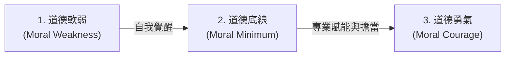

# 倫理連續光譜（The Ethical Continuum）

倫理學家提出「倫理連續光譜（Ethical Continuum）」理論，將個人的道德表現劃分為三個循序漸進的關鍵坐標點：

---

## 1. 道德軟弱（Moral Weakness）
* **特徵**：在道德誘惑面前屈服，明知某行為違反原則，但因私利、膽怯、人情或害怕被群體孤立，選擇「隨波逐流」或同流合汙。
* **職場表現**：
  * 「反正別人都拿文具，我也順手拿兩支。」
  * 「主管叫我偽造日誌，我不做可能會被開除，所以我照簽了。」
* **哲學診斷**：完全背棄了康德的普遍法則公式，成為他人或自身脆弱慾望的被動工具。

---

## 2. 道德底線（Moral Minimum）
* **特徵**：消極守法，做到「我不做壞事（Not actively unethical）」。以法律與正式規章作為個人的最高行為準則。
* **職場表現**：
  * 「只要公司沒規定不能做、法律沒罰，我就做。」
  * 「我看見同事在作弊，但我自己絕不作弊；我也不會去檢舉，不關我的事。」
* **局限性**：處於此層次者常陷入**消極旁觀者效應**。面對體制漏洞或系統性不正義時，缺乏主動糾錯的意願。

---

## 3. 道德勇氣（Moral Courage）
* **特徵**：**主動道德能動者（Proactive Moral Agent）**。即使面臨實質的人際衝突、職業風險、甚至經濟受損，依然主動挺身捍衛正義、保護弱者。
* **職場表現**：
  * 志偉堅決拒絕在致命資安漏洞上簽署核可（[[case-05-tech-safety-boss-pressure]]）。
  * 小雯堅持推進醫療團隊召開正式病情說明會，捍衛臨終病患的知情尊嚴（[[case-01-hospital-privacy-disclosure]]）。
* **哲學指引**：實踐羅斯「不傷害原則」與康德「人是目的」的最高道德尊嚴。
