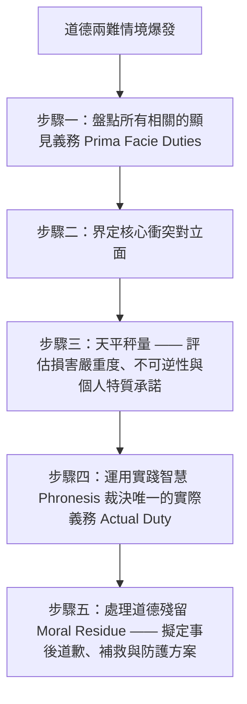

# 羅斯顯見義務衝突權衡模型（Prima Facie Balancing Framework）

本模型奠基於 W. D. Ross 的多元直覺義務論，並結合當代哲學界（如 Matthew Pianalto 等學者）對「天平秤量法（Moral Weighing）」的闡釋，專門提供給專業從業人員在面臨兩難抉擇時進行結構化分析：

---

## 五步深思熟慮決策流程表（Considered Judgment Steps）

### 步驟一：全面盤點顯見義務（Identifying Prima Facie Reasons）
* 檢視羅斯七大顯見義務：**忠實、補償、感恩、正義、行善、自我提升、不傷害**。
* 找出在此情境中，有哪些義務正在向你提出道德要求？

### 步驟二：界定核心衝突焦點（Locating the Core Clash）
* 明確劃出是哪兩項（或多項）義務在天平兩端拔河：
  * 例如：對主管的「忠實/守諾義務」 vs. 對公眾的「不傷害義務」。
  * 例如：對學生的「正義公平義務」 vs. 對自身職涯的「自我保全/提升義務」。

### 步驟三：天平秤量與損害評估（Weighing Moral Reasons）
* 評估違背各項義務所引發的實質代價：
  * 是否涉及生命安全或不可逆的重大損害？
  * 是否破壞了專業人士與當事人之間的**特殊受託信任關係（The Highly Personal Character of Duty）**？

### 步驟四：確立實際義務（Determining the Actual Duty）
* 運用理性與實踐智慧（Phronesis），牢記兩大羅斯黃金法則：
  1. **不傷害原則（Non-Maleficence）具有壓倒性最高權重**。
  2. 角色特殊受託責任（Special Fiduciary Obligations）重於泛化的抽象人際和諧。
* 判定在此情境中，哪一項義務晉升為唯一不可推卸的**實際義務（Duty Proper）**。

### 步驟五：處理道德殘留（Managing the Moral Residue）
* 羅斯指出，被暫時壓倒的次要義務並未消失，會轉化為「道德殘留」。
* 行動者必須擬定配套措施：誠懇說明理由、主動道歉、提供後續補救或啟動制度防護，化解被犧牲方的傷害。

---

## 職場決策實踐範例
* **在 [[case-05-tech-safety-boss-pressure]] 中**：
  * 忠實義務（對主管聘約承諾） vs. 不傷害義務（對數百萬存戶資金安全）。
  * 秤量結果：不傷害義務以絕對重量壓倒忠實義務；工程師的實際義務是**堅決拒絕簽署不實安全部署單**，並在事後提供建設性工程緩解方案以處理道德殘留。
